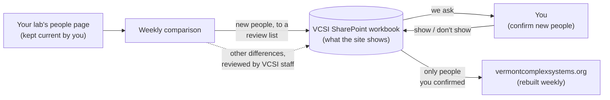
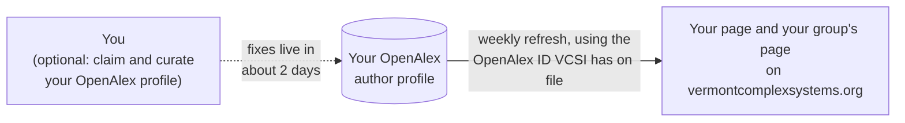

# How your lab appears on the VCSI website

This page is for VCSI faculty. It explains where the people and publications on
[vermontcomplexsystems.org](https://vermontcomplexsystems.org) come from, what
we expect from you, and how to fix things that look wrong.

## The short version

- **Your lab website is the reference for who is in your lab.** We read it; we
  never edit it. If it's out of date, the VCSI site will drift too.
- **New people wait for your OK.** Someone new on your lab page goes on a review
  list, and only appears on the VCSI site once you confirm they belong there.
  Other changes are reviewed by a VCSI staff member before going live.
- **The VCSI site can differ from your lab page on purpose.** Not everyone in a
  lab is part of VCSI, and we add information your page doesn't have.
- **Publications come from [OpenAlex](https://openalex.org)**, an open scholarly
  database. If your paper list looks wrong, you can fix it at the source.

## People: from your lab page to the VCSI site

Once a week, a script reads your lab's people page and compares it with the
SharePoint workbook the website is built from:

- **New people** on your lab page are put on a review list in the workbook. We
  ask you whether they should appear on the VCSI site, and add them if so.
- **Other differences**, such as "listed as former on the lab page but still
  current here" or "same person under a slightly different name?", are
  reviewed by a VCSI staff member, who updates the workbook.

Because people are in the loop, changes on your lab page usually show up on the
VCSI site within a week or two, not instantly.

### What helps

- **Keep current and former members in separate sections** of your people page.
  This is how we tell who has left.
- **Update the page when people join or leave.** If your page hasn't changed in
  six months, we stop using it to decide who has left, since we can't tell an
  inactive page from a stable lab. New names are still picked up.
- **Use the same name everywhere.** "Alex Doe" on your page and "Alexander
  Doe" in our records is fine; "Jane Doe" vs "Jane Dow" makes us ask.

### When the VCSI site intentionally differs from your lab page

- **Not everyone in your lab is part of VCSI.** For example, a PhD student
  visiting from another university may belong on your lab page but not on the
  institute's. If you tell us so, they stay on the review list and we won't ask
  again.
- **We add information.** Short bios, OpenAlex IDs and institute roles are
  maintained on our side in the SharePoint workbook.
- **Photos start from your lab page.** For new people we take the photo from
  your lab page as a starting point. If someone prefers a different photo on the
  VCSI site, send it to us; we replace it on our side and won't overwrite it with
  the lab page's version later.

If you think someone is wrongly listed, missing, or hidden, contact the VCSI
web team at [vcsi@uvm.edu](mailto:vcsi@uvm.edu).

### Which labs are compared automatically

Joint Lab and the Computational Story Lab so far. Other labs are updated by
hand. Adding your lab needs a public people page; tell us its address.

## Publications: from OpenAlex to the VCSI site

For each faculty member we have an OpenAlex ID for, the site shows every work
OpenAlex attributes to that profile, along with citation counts and
topics. The only processing on our side is merging duplicates, such as a
preprint and its published version.

OpenAlex assigns papers to authors automatically, so it can get things wrong:
a paper by someone with a similar name, or a paper of yours that is missing.

### Fixing your paper list

You can curate your own OpenAlex profile
([OpenAlex help](https://help.openalex.org/access/fixing-errors/authors/)):

1. Create a free account at [openalex.org](https://openalex.org) and sign in.
2. Search for your name and open your profile.
3. Click **Claim**. Approval is instant if your account has a verified
   university email, or if you link your ORCID.
4. Add missing works (by title, DOI, or CV upload) and remove ones that aren't
   yours.

OpenAlex applies changes within about two days. The VCSI site picks them up on
its next weekly refresh, including removing works you detached.

If your profile is split across several OpenAlex IDs, or we have the wrong one,
contact [vcsi@uvm.edu](mailto:vcsi@uvm.edu).
