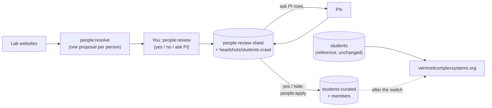

# People audit

Keeps the students and members sheets in the VCSI-web SharePoint workbook in
step with each group's own website. Lab pages are read by one small scraper per
group (`sources/`); everything they find is a suggestion. No script ever writes
to a sheet or folder the site is built from (`students`, `members`, `groups`,
…, `assets/headshots/students`); `sharepoint.js` refuses. The faculty-facing
explanation is in [docs/for-faculty.md](../../docs/for-faculty.md).

## Reviewing people

```sh
npm run people:resolve              # proposals for the focus groups -> people-resolved.csv
npm run people:review               # resolve, then decide on each proposal in the terminal
npm run people:review -- --all      # also revisit decisions already made
npm run people:review -- --sheet    # resolve, then publish everything as the people-review sheet
npm run people:apply                # dry run: the exact changes your yes/hide decisions make
npm run people:apply -- --write     # make them in students-curated and members
```

`people:resolve` merges each person across lab pages and both sheets and
proposes one action: `add`, `reactivate?`, `add group`, `remove group`,
`mark alumni`, `end affiliation?`, `not on lab page` or `same person?`, with
the reason. People who already agree, and former lab members we never listed,
are left out. It covers the core labs in `FOCUS` (resolve.js) unless you name
groups.

`people:review` walks through the open proposals: `y` yes, `n` no (don't ask
again), `a` ask PI, `s` skip, `q` quit. Each answer is saved straight away to
`people-decisions.csv`, so you can stop and resume. A decision belongs to a
person and an action; if new evidence changes the proposed action, it comes
back.



`people:apply` makes the approved (`yes` / `hide`) changes. Student changes go
to **`students-curated`**, created on the first `--write` as a copy of
`students`; **`students` itself is kept unchanged as a reference**, and the
site keeps reading it until it is switched over to `students-curated`. Member
changes go to `members`. Every cell is re-checked just before writing, so
edits made in SharePoint meanwhile win, and running it twice changes nothing.
`hide` adds the person with `show = 0`. Approved photos stay in
`assets/headshots/students-crawl` until the switch (`--photos` copies them into
`assets/headshots/students`). Once applied, the curated sheet agrees with the
lab page and the proposal disappears: the audit and resolve read
`students-curated` once it exists.

Decisions live in two places: your local `people-decisions.csv`, and the
`people-review` sheet once published (exported to `src/data/people-review.csv`
by `msgraph:fetch`, so decisions made in SharePoint count too). The most
recently decided wins. All three files are gitignored: notes about named people
don't belong in this public repo.

To hide someone already in `students` without deleting the row, set an
optional `show` column to `0` (blank or `1` = shown; see `isShown()` in
`src/lib/people.js`).

## How it decides

- **Matching is by name**, since every lab site has its own slugs. Small
  differences count as the same person (middle names, Will/William, Jim/James,
  St. Onge/St-Onge). Closer calls (Erik Weis/Weiss) become `same person?`.
- **Lab membership is not VCSI affiliation.** Someone former on one lab page
  but current on another (PhD in one lab, postdoc in another) is still here:
  `remove group`, not `mark alumni`. Only someone former everywhere we look is
  proposed as alumni.
- **Departures need a fresh page** (changed in the last 180 days,
  `FRESH_FOR_DAYS`). A stale page says nothing about who left; its adds are
  flagged as coming from a stale page.
- **Faculty and staff are never moved** based on a lab page. Postdocs and
  researchers in the members sheet who are former on every lab page get
  `end affiliation?`. `retired` in the members sheet means they've left.
- **Former lab members we never listed are left out.** We don't backfill alumni.
- **A source that fails or returns nobody is skipped** with a note, never read
  as "everyone left".

## Weekly report

```sh
npm run people:audit                # every group in sources/
npm run people:audit -- joint-lab   # one group
```

Runs in CI after the SharePoint fetch; the report appears on the GitHub Actions
run summary page. Same evidence, per group, as text. New people who already
have a decision aren't repeated. It never writes anything.

## The raw comparison

```sh
npm run people:crawl                # people-crawl.csv (gitignored) + a summary per group
npm run people:crawl -- --sheet     # also write it to the "crawled-people" worksheet
npm run people:crawl -- --photos    # also download current members' photos
npm run people:crawl -- --upload    # --photos, then upload new ones to SharePoint for review
```

`--photos` saves each current member's photo as
`crawled-photos/<group>/<id>.jpg`: 400px square, cropped around the face,
named with our id when we have one (so an approved photo can be dropped into
the SharePoint `assets/headshots/students` folder as is). The folder is
gitignored and outside `static/`, so nothing is deployed. Existing files are
kept; delete the folder to re-download. The `our_photo` column says whether the
site already has a headshot for that person.

`--upload` copies the photos of people the site has no headshot for into the
SharePoint folder `assets/headshots/students-crawl`, next to the site's
`assets/headshots/students`. A file already in the review folder is never
replaced, so it is safe to swap in a better photo there by hand (say, one the
person prefers for the VCSI site over the one on their lab page). Delete a file
in SharePoint to have the next upload fetch it fresh from the lab page.

One row per person per group: everyone on the lab pages, plus everyone our
sheets list for a crawled group who isn't on its page. The `comparison` column
is for filtering in Excel: `agrees`, `missing from ours`, `differs`,
`only in ours`, `other group in ours`, `in members`, `same person?`,
`former, not in ours`. Useful for checking a new scraper, and for seeing what
manual curation added or left out.

`--sheet` creates the worksheet, or replaces its contents on later runs. It
refuses to overwrite a sheet that doesn't start with its `group, name, comparison` columns. `msgraph:fetch` skips it
(only sheets in `EXPORTED_SHEETS` in `scripts/fetch-msgraph.js` are), so it never becomes site data.

## Adding a group

Add a file to `sources/` named after the group id. It must export:

```js
export default {
	group: 'comp-story-lab', // id in the groups sheet
	url: 'https://…', // the page a person can check
	async fetch() {
		return {
			lastChanged, // Date the people list last changed, or null if unknown
			people: [
				// status: 'current' or 'alumni'. Optional: staff, url, email,
				// photo (absolute URL of their headshot, from the same card as the name)
				{ name, role, status }
			]
		};
	}
};
```

Every site is different, so each file is a small scraper for one site. Prefer,
in order:

1. **Structured data the site already publishes.** Gatsby/Next sites expose
   page JSON, and Jekyll/Hugo sites usually keep people in a data file in their
   repo. See `joint-lab.js`.
2. **The HTML**, using `node-html-parser` and the page's headings to tell
   current from former members. See `comp-story-lab.js`.

For `lastChanged`, use the best evidence of when the people list itself
changed: the last commit touching the people files, or a `Last-Modified` header
from a plain web server. GitHub Pages' `Last-Modified` is the last deploy of
the whole site, so it's a weaker signal. If you have nothing, return `null`.
The group is then treated as stale: new names are still suggested, departures
aren't.

When a lab redesigns its site, the scraper will usually find nobody and the
report will say so. Update the file then.
