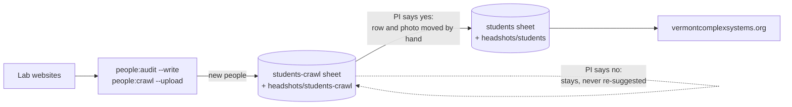

# People audit

Compares each group's own website with the students and members sheets, and
prints suggestions for a person to apply in the VCSI-web SharePoint workbook.

```sh
npm run people:audit                # every group in sources/
npm run people:audit -- joint-lab   # one group
npm run people:audit -- --write     # also add new people to the students-crawl review sheet
```

Without `--write` it never writes anywhere. No script ever writes to a sheet
or folder the site is built from (`students`, `members`, `groups`, …,
`assets/headshots/students`); `sharepoint.js` refuses. It also runs in CI
(report only) after the SharePoint fetch, and the report appears on the GitHub
Actions run summary page. The faculty-facing explanation is in
[docs/for-faculty.md](../../docs/for-faculty.md).

## The raw comparison

```sh
npm run people:crawl                # people-crawl.csv (gitignored) + a summary per group
npm run people:crawl -- --sheet     # also write it to the "crawled-people" worksheet
npm run people:crawl -- --photos    # also download current members' photos
npm run people:crawl -- --upload    # --photos, then upload new ones to SharePoint for review
```

`--photos` saves each current member's photo as
`crawled-photos/<group>/<id>.jpg`: 400px square, cropped around the face,
named with our id when we have one (so an approved photo can be dropped into
the SharePoint `assets/headshots/students` folder as is). The folder is
gitignored and outside `static/`, so nothing is deployed. Existing files are
kept; delete the folder to re-download. The `our_photo` column says whether the
site already has a headshot for that person.

`--upload` copies the photos of people the site has no headshot for into the
SharePoint folder `assets/headshots/students-crawl`, next to the site's
`assets/headshots/students`. A file already in the review folder is never
replaced, so it is safe to swap in a better photo there by hand (say, one the
person prefers for the VCSI site over the one on their lab page). Delete a file
in SharePoint to have the next upload fetch it fresh from the lab page.

One row per person per group: everyone on the lab pages, plus everyone our
sheets list for a crawled group who isn't on its page. The `comparison` column
is for filtering in Excel: `agrees`, `missing from ours`, `differs`,
`only in ours`, `other group in ours`, `in members`, `same person?`,
`former, not in ours`. Useful for checking a new scraper, and for seeing what
manual curation added or left out.

`--sheet` creates the worksheet, or replaces its contents on later runs. It
refuses to overwrite a sheet that doesn't start with its `group, name, comparison` columns. `msgraph:fetch` skips it
(see `EXCLUDED_SHEETS`), so it never becomes site data.

## How it decides

- **Matching is by name**, since every lab site has its own slugs. Small
  differences count as the same person (middle names, Will/William,
  St. Onge/St-Onge). Closer calls (Erik Weis/Weiss, Andi/Andrea) are listed
  under "Same person?" rather than guessed.
- **Everyone new goes to the review sheet.** Someone current on the lab page
  who is in neither people sheet gets a pre-filled row for `students-crawl`
  (pasted by hand, or appended by `--write`). Their PI decides; approved rows
  are moved into `students` by hand.
- **The review sheet is the memory.** People already in `students-crawl`,
  waiting or declined, aren't suggested again; the report just counts them.
- **Departures are only suggested when the lab page is fresh** (changed in the
  last 180 days, see `FRESH_FOR_DAYS`). A stale page says nothing about who left.
- **Members (faculty, staff) are not moved between statuses** based on a lab
  page. The one exception is a postdoc listed as former on the lab page who has
  no active row elsewhere: they get a "still at VCSI?" question.
- **Former members who aren't in our sheets are not suggested.** We don't
  backfill lab alumni.
- **A source that fails or returns nobody is skipped** with a note, never read
  as "everyone left".

## Review workflow



The review sheet and folder are where VCSI-side edits live before anything is
published: fix a name, a role or a photo there, and later crawls leave it be.

`--write` matches columns by header name, so the review sheet can be a copy of
`students`. It checks names against the live review sheet, not the local CSV,
so running it twice adds nothing.

To hide someone already in `students` without deleting the row, set an
optional `show` column to `0` (blank or `1` = shown; see `isShown()` in
`src/lib/people.js`).

## Adding a group

Add a file to `sources/` named after the group id. It must export:

```js
export default {
	group: 'comp-story-lab', // id in the groups sheet
	url: 'https://…', // the page a person can check
	async fetch() {
		return {
			lastChanged, // Date the people list last changed, or null if unknown
			people: [
				// status: 'current' or 'alumni'. Optional: staff, url, email,
				// photo (absolute URL of their headshot, from the same card as the name)
				{ name, role, status }
			]
		};
	}
};
```

Every site is different, so each file is a small scraper for one site. Prefer,
in order:

1. **Structured data the site already publishes.** Gatsby/Next sites expose
   page JSON, and Jekyll/Hugo sites usually keep people in a data file in their
   repo. See `joint-lab.js`.
2. **The HTML**, using `node-html-parser` and the page's headings to tell
   current from former members. See `comp-story-lab.js`.

For `lastChanged`, use the best evidence of when the people list itself
changed: the last commit touching the people files, or a `Last-Modified` header
from a plain web server. GitHub Pages' `Last-Modified` is the last deploy of
the whole site, so it's a weaker signal. If you have nothing, return `null`.
The group is then treated as stale: new names are still suggested, departures
aren't.

When a lab redesigns its site, the scraper will usually find nobody and the
report will say so. Update the file then.
