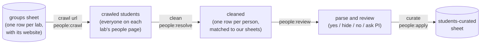

# src/data

The CSVs here are exports of the VCSI-web SharePoint workbook
(`vcsi-website-data.xlsx`, plus `publications.xlsx` for `publications/`).
`npm run msgraph:fetch` writes them, and CI runs it every week, so **edit the
workbook, not these files**: changes made here are overwritten on the next
fetch. Only the sheets listed in `EXPORTED_SHEETS` (`scripts/fetch-msgraph.js`)
are exported, because this folder is committed to a public repo.

## How we got the students

1. **Groups sheet.** Each lab has a row with its website. Each lab also has a
   small scraper in `scripts/people-audit/sources/<group id>.js` that knows how
   to read that site's people page, since every site is laid out differently.
2. **Crawl** (`npm run people:crawl`). Everyone listed on the lab pages, current
   and former, with their role, links and photo. The raw result is the
   `crawled-people` sheet, and photos go to the SharePoint folder
   `assets/headshots/students-crawl`.
3. **Clean** (`npm run people:resolve`). Names are matched to our sheets
   ("Jenn Ha" is "Jennifer Ha"), people on several lab pages are merged, and
   anyone who already agrees with our sheets is dropped. What's left is one
   proposal per person: add, mark alumni, add a group, and so on, with the
   reason.
4. **Review** (`npm run people:review`). A person goes through each proposal:
   `yes`, `hide` (right person, not shown on the site), `no` (wrong), or
   `ask PI`. Decisions can be shared as the `people-review` sheet.
5. **Curate** (`npm run people:apply`). Approved changes are written to the
   `students-curated` sheet, which becomes `students-curated.csv` here.

The `students` sheet is the hand-made list we started from. It is kept
unchanged as a reference, and the site reads it until it's switched over to
`students-curated`. Whether someone appears on the site is the `show` column:
blank or `1` shows them, `0` hides them.

The details (matching rules, adding a lab, photos) are in
[scripts/people-audit/README.md](../../scripts/people-audit/README.md). How this
is explained to faculty is in [docs/for-faculty.md](../../docs/for-faculty.md).

## Files

| File                       | Sheet             | Used for                                                  |
| -------------------------- | ----------------- | --------------------------------------------------------- |
| `members.csv`              | members           | Faculty, staff and affiliates (Who We Are, profile pages) |
| `students.csv`             | students          | Students on the site today; the reference list            |
| `students-curated.csv`     | students-curated  | The reviewed list of students (see above)                 |
| `groups.csv`               | groups            | Research groups and their websites                        |
| `projects.csv`, `misc.csv` | projects, misc    | Projects and other initiatives, with member ids           |
| `events.csv`               | events            | Events page                                               |
| `course-urls.csv`          | course-urls       | Courses fetched from the UVM API                          |
| `publications/*.csv`       | publications.xlsx | DOI lists for project pages                               |

`people-review.csv` is also exported but gitignored, since decision notes are
about named people. `courses.json`, `electives.js` and
`talkboctopus-playlist.csv` aren't from the workbook.

`npm run data:check` reports problems in these files by sheet and row, so they
can be fixed in the workbook.
